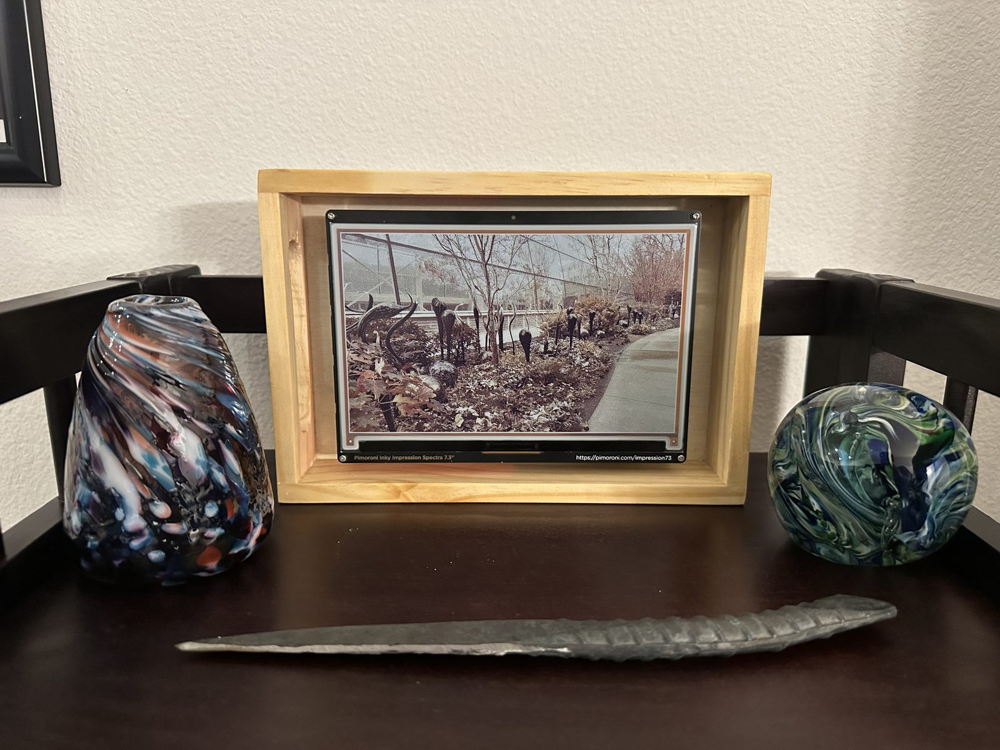
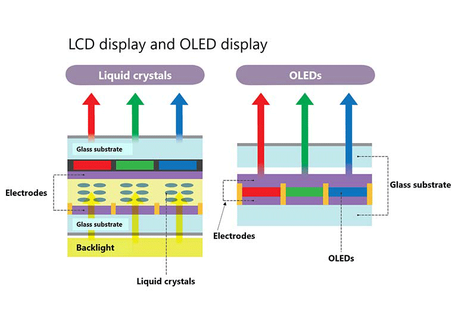

Electronic ink (e-ink) is such an interesting technology: it can hold pixels on a screen without any active power! Modern OLED displays like your TV or phone or laptop require constant power to keep each pixel active and emitting light (either directly or through a backlight) but e-ink just needs power to *change* the pixels. This also makes it much easier on your eyes: e-ink on its own doesn't emit light at all! Using it in the dark requires a backlight screen though. These kinds of displays are particularly good at reading and writing, e.g., Amazon Kindle and Remarkable, and just displaying static things for a long period of time while consuming minimal power. Modern e-ink displays can even render full color which makes it a great candidate for a picture frame!

Story for those that care: I sifted through some boxes after I finished moving and found a toolbox with a bunch of old boards that haven't seen the light of day in ages. Rather than keep them in their cardboard prison, I decide to see what I could build with some of these boards. I had an Udoo x86 board (I think one of the earliest CISC architecture boards in a world of RISC architecture boards), a Jetson Nano dev kit (stuck on Ubuntu 18.04 and an ancient version of Jetpack), some Romeo boards with built-in H-bridge motor drivers, and finally assorted Raspberry Pis, from the Pi 2 to the Pi 4. The Udoo, Pi 2, and Jetson Nano were basically at the end of their lives so I enshrined them on a beautiful plank of walnut as an exercise in woodworking so that left a few Raspberry Pi 3s and a Raspberry Pi 4. I was thinking about what I could do with these when the idea came to me while reading on my Kindle: an e-ink display! What would I show? Just some pictures I took but I'd encase the display in a nice wooden box since I like that aesthetic.

AI Disclaimer: I iterated on the software for the e-ink display using Claude Code with a focus of cutting down features and making the end code more human-interpretable so I can still learn from it and make modifications. No AI was used in the writing of this post through. AI is still horrendous at writing "naturally" and while I've tried using it for work documents, they often come out stiff and unlike my usual flow of writing. Plus I enjoy this kind of technical writing and it helps me learn and organize my thoughts a bit more cleanly. And, of course, I wouldn't want to disrespect you either, dear Reader. All colons and em dashes are human-generated!

## E-ink

Before we get to the code and construction, I'll take a brief minute to explain how e-ink even works. Modern LCD/LED display have a layer of liquid crystals sandwiched between electrodes and use electricity to align liquid crystals (plus a backlight) to project the light of those crystals to the user's eye. OLED displays have each pixel being a little LED that emits light without a backlight.


<small><i>Source: https://global.canon/en/technology/canon-tech/tech/oled-display/</i></small>

Both of these require active power since the liquid crystals need to hold their configuration and the backlight needs to shine or the LEDs themselves need to be powered to emit light.

E-ink is built differently: at a high level, each "pixel" is a microcapsule filled with a viscous oil and electrically charged micropigments. Monochrome e-ink has positively-charged black pigment particles and negatively-charged white pigment particles. These microcapsules are sandwiched between two electrodes. When a positive or negative voltage is applied across those electrodes, the white and black pigments separate and we see either a white or black pixel, and the viscousity of the oil mediums holds the pigments in place (the technical term is **bistable**). What if we wanted to see different shades of grey? Grey is just some mixture of white and black pigments so we can't blindly apply a voltage across the electrodes. Instead, there's a more complicated control scheme where we apply voltages on a schedule, almost like pulsing them, until we get the right mixture of white and black pigments.


<small><i>Source: https://en.wikipedia.org/wiki/E_Ink</i>
1. Upper layer
2. Transparent electrode layer
3. Transparent micro-capsules
4. Positively charged white pigments
5. Negatively charged black pigments
6. Transparent oil
7. Electrode pixel layer
8. Bottom supporting layer
9. Light
10. White
11. Black
</small>

The e-ink display that we're going to be using has multiple colors but the principle is the same: each color pigment is positively or negatively charged, *but not at the same level*. In other words, we can have some strongly positively-charged pigments and some weakly positively-charged pigments. So that already gets us four possible varieties total. Another dimension that's commonly used is the mass of the pigments: lighter pigments move quickly while heavier pigments move slowly. The control scheme becomes more complicated where the controller produces voltage waveforms instead of just a uniform voltage. For example, high voltage pulses could rapidly bring lighter pigments to the front. It's easy to jump into the details and I encourage you to do so if you're interested!

## Hardware

Speaking of e-ink displays, I wanted something with full color for rendering my photos so I went with the [Pimoroni Inky Impression Spectra 7.3"](https://shop.pimoroni.com/products/inky-impression?variant=55186435244411). The size was large enough to fill a small wooden box plaque that I found in a Michaels but you could make your own. The Spectra does have four built-in buttons that I wanted access to for moving to the next/previous picture, one for showing the status with the IP (to make SSH easy), and a shutdown one that clears the e-ink screen. I took the wooden plaque box and make a cutout on the side (drill + coping saw) so I could access the buttons. I also made a small cutout on the back to route the power cable through and bought a 90-degree micro-USB adapter so the cable moves perpendicular to the back panel and not parallel so I didn't have to bend the cable by 90 degrees. 

The Spectra is a Pi hat so it just fits right into the entire header. Since my Pi 2 was becoming a display piece, I used a Pi 3 as the main board. (The additional benefit is that the Pi 3 has onboard WiFi so no need for a WiFi dongle!) The Spectra slots right into the Pi header and I wasn't planning on using the Pi for anything else anyways and the entirely of the Pi hides behind the display. 

For the mounting, I used M2 x 25mm standoffs that hold the Spectra+Pi up. I used M2 screws to connect the Spectra to the standoffs (washers on the PCB side to distribute the weight) and then screws on the backside of the wooden box to hold the standoffs to the box. After dry-fitting everything just to make sure, I oiled the wood and let it cure for a few days before the final assembly.

While that was happening, I set up the Pi and flashed an SD card with the latest Pi OS. As long as the hostname is set, I could ssh easily with just `ssh pi@mohit-eink.local`. I ran `ssh-copy-id pi@mohit-eink.local` just so I didn't have to keep typing the password over (it copies over your local public key). And that was it for the hardware!

## Software

The software architecture is fairly straightforward. As mentioned in the disclaimer, I did use Claude Code to generate and iterate on this so I won't claim I wrote all of this by hand although I did inspect every line and iterated to cut scope and force interfaces that I thought were a cleaner separation of concerns than what Claude produced.

At a high level, we have a main thread and a button thread managed by gpiozero. The main thread initializes everything and is responsible for rendering images and holding a lock on the GPIO pins for the buttons. After an image is rendered, the main thread goes to sleep until it's time to show the next image however we need to service button presses. Busy-looping is a bad idea since it eats up CPU and other resources so we'll use condition variables to put the main thread to sleep but we'll also have an event queue. Since gpiozero uses a separate thread to service button requests, that thread simply puts a button into the queue which then wakes up our main thread to service the button call and then go back to sleep.

All of the [code](https://github.com/mohitd/eink-picture-frame) is on my GitHub so follow along!

Our `main.py` is the starting point.

```python
def main() -> int:
    setup_logging()
    config = load_config(CONFIG)
    log.info("eink-picture-frame starting")

    try:
        display = Display(config)
    except Exception as e:
        log.error(f"Could not initialise the panel: {e}")
        # auto() identifies the board by reading an I2C EEPROM, so an EEPROM
        # error usually means I2C is off rather than anything wrong with SPI.
        log.error("Check that SPI and I2C are both enabled (raspi-config) "
                  "and that the HAT is seated properly.")
        return 2

    controller = Controller(config, display)
    signal.signal(signal.SIGTERM, lambda *_: controller.stop())
    signal.signal(signal.SIGINT, lambda *_: controller.stop())

    try:
        controller.run()
    except Exception:  # log the traceback before systemd restarts us
        log.exception("Fatal error")
        return 1

    log.info("Stopped")
    return 0

if __name__ == "__main__":
    sys.exit(main())
```

The end has the canonical Python check `if __name__ == "__main__"` for accidental library imports. We start by initializing logging:

```python
log = logging.getLogger("frame")

def setup_logging() -> None:
    # systemd sets JOURNAL_STREAM, and journald stamps its own timestamps, so
    # only add ours when running by hand.
    fmt = "%(levelname)-7s %(name)-10s %(message)s"
    if "JOURNAL_STREAM" not in os.environ:
        fmt = "%(asctime)s " + fmt
    logging.basicConfig(level=logging.INFO, format=fmt, datefmt="%H:%M:%S", stream=sys.stdout)
    logging.getLogger("PIL").setLevel(logging.WARNING)
```

We'll later set up our systemd so that we're writing to the Linux journald logger so we can always check logs after-the-fact. We also get free log rotation and a bunch of other goodies compared to spinning up our own logging structure. Since we're using Pillow (PIL), we also configure its logger level to avoid cluttering the logs.

Next up is the config which looks like this.

```
[photos]
directory = "/home/pi/Pictures"

[display]
rotation = 0    # 0 | 90 | 180 | 270

# How a photo is mapped onto the 800x480 panel. For a 4:3 iPhone shot:
#   letterbox - whole photo, white bars   (fills 80% of the panel)
#   fill      - scale to cover, then crop (loses 20% of the photo)
#   stretch   - distort to fit exactly    (makes it 25% too wide)
fit = "fill"

# How the driver picks palette colours when quantizing, 0.0-1.0. Counter-
# intuitively, *raising* this reduces the red cast on warm photos: it quantizes
# against the muted inks the panel really produces rather than pure RGB, and
# fewer mid-tones end up on red. Too high washes out to grey and yellow.
saturation = 0.75

[slideshow]
# Each refresh is ~40s of visible flashing, so don't go below ~300.
# 0 disables auto-advance and leaves it button-only.
interval = 300
```

Nice and simple! I made the intentional choice to avoid complex settings; if you want to add more feel free! We load this config from the same directory as this source code for simplicity.

```python
CONFIG = Path(__file__).resolve().parent / "config.toml"
```

And the loading code uses the `toml` library for the brunt of the work.

```python
"""Config loading. Durations are in seconds.

Every value is required, so a missing key is a KeyError at startup rather than
a silent default.
"""

import tomllib
from dataclasses import dataclass
from pathlib import Path

FITS = ("letterbox", "fill", "stretch")


@dataclass(frozen=True, slots=True)
class Config:
    photo_dir: Path
    rotation: int
    fit: str
    saturation: float
    interval: float | None


def load_config(path: Path) -> Config:
    with path.open("rb") as file:
        raw = tomllib.load(file)

    interval = float(raw["slideshow"]["interval"])
    fit = raw["display"]["fit"]
    if fit not in FITS:
        raise ValueError(f"display.fit must be one of {FITS}, not {fit!r}")

    return Config(
        photo_dir=Path(raw["photos"]["directory"]).expanduser(),
        rotation=int(raw["display"]["rotation"]) % 360,
        fit=fit,
        saturation=float(raw["display"]["saturation"]),
        interval=interval if interval > 0 else None,
    )
```

The next thing we see in `main` is the `Display` that consumes the config (to cache the saturation to send to the e-ink display) and simply draws to the screen.

```python
"""
Everything else hands it plain RGB; the driver does the quantizing and
dithering, so nothing outside this file knows the panel's palette.
"""

import logging
import time

from inky.auto import auto
from PIL import Image

from render import Size

log = logging.getLogger(__name__)


class Display:
    def __init__(self, config) -> None:
        self._device = auto(ask_user=False, verbose=False)
        self._saturation = config.saturation
        # The panel reports its own resolution - it isn't a setting, and
        # nothing knows it until auto() has identified the board.
        self.size = Size(self._device.width, self._device.height)
        log.info(f"Panel: {type(self._device).__name__} {self.size.width}x{self.size.height}")

    def show(self, image: Image.Image) -> None:
        started = time.monotonic()
        self._device.set_image(image, saturation=self._saturation)
        self._device.show()
        log.info(f"Panel refresh took {time.monotonic() - started:.1f}s")
```

The most important part of the architecture is that this is the only file that imports `inky` so we don't bleed access to the display everywhere. The `Size` that's imported from `render.py` is a simple class:

```python
class Size(NamedTuple):
    width: int
    height: int
```

The `Controller` class is the main runner. So far, we've seen the constructor, `run`, and `stop` functions on it.

```python
class Controller:
    def __init__(self, config, display) -> None:
        # Collaborators: set once, never reassigned.
        self._config = config
        self._display = display
        self._panel = display.size
        self._queue: queue.Queue[str] = queue.Queue()

        # Photos we've failed to decode. Not part of the View: it's what we've
        # learnt, not what we're showing, and it outlives any one photo.
        self._broken: set[Path] = set()


    def stop(self) -> None:
        """Ask the loop to finish. Safe to call from a signal handler."""
        self._queue.put("quit")
```

We cache a bunch of input but here's where the event queue `self._queue` comes in. We also keep track of photos that we can't load for whatever reason and we keep a list of those so we don't try to select those again. The `stop` function puts an event on the queue that causes the main thread to wake up. The brunt of the code lives in the `run` function.

```python
    def run(self) -> None:
        """Draw the first photo, then loop until stopped.

        The buttons are claimed for exactly this window - they only mean
        anything while the loop is here to consume what they queue.
        """
        with Buttons(self._queue.put):
            view = View(current=self._pick(avoid=None))
            view = self._draw(view)
            deadline = self._next_deadline()

            while True:
                batch = self._next_batch(deadline)

                if "shutdown" in batch:
                    self._shutdown()
                    return
                if "quit" in batch:
                    return

                updated = self._apply(batch, view)
                if updated != view:  # nothing changed means nothing to redraw
                    view = self._draw(updated)
                    deadline = self._next_deadline()

```

There are a few things going on here. We have a scope with the `Buttons` class that initializes each of the buttons of the e-ink screen and holds a reference to them to keep control over those pins. Whenever a button is pressed, we put it in the event queue as per the constructor taking the `self._queue.put` function. The button logic starts by caching a function for the buttons to call.

```python
class Buttons:
    """The buttons, live for as long as a `with` block:

        with Buttons(queue.put):
            ...          # buttons work in here
        ...              # pins released again

    It has to be scoped like that because gpiozero releases a pin the moment
    its Button object is garbage collected. Something must hold them for the
    whole time they're needed, and that something is this object.
    """

    def __init__(self, emit) -> None:
        # emit(action) is called from gpiozero's threads, so whatever is passed
        # in has to be safe to call from another thread. queue.put is.
        self._emit = emit
        self._claimed: list[Button] = []
```

When we enter a scope, we hold a reference to a button given the mapping we supply. I've hardcoded this for simplicity but feel free to change the mapping to whatever!

```python
BOUNCE_TIME = 0.08  # ignore contact chatter for 80ms after a press
HOLD_TIME = 2.0     # how long "hold" buttons must be held


class Binding(NamedTuple):
    label: str
    pin: int  # BCM numbering
    action: str
    hold: bool = False


LAYOUT = [
    Binding("A", 5, "prev"),
    Binding("B", 6, "next"),
    Binding("C", 16, "status"),
    Binding("D", 24, "shutdown", hold=True),
]

class Buttons:
    def __enter__(self) -> "Buttons":
        """Runs when the `with` block starts: claim a pin per button."""
        for label, pin, action, hold in LAYOUT:
            try:
                button = Button(
                    pin, pull_up=True, bounce_time=BOUNCE_TIME, hold_time=HOLD_TIME
                )
            except Exception as e:  # pin busy, bad number, no permission
                log.error(f"Could not claim GPIO {pin} for button {label}: {e}")
                continue  # a dead button beats no photo frame

            callback = _make_callback(self._emit, label, action)
            if hold:
                button.when_held = callback  # fires after HOLD_TIME
            else:
                button.when_pressed = callback  # fires the moment it goes down

            self._claimed.append(button)
            log.info(f"Button {label} on GPIO {pin}: {action}{' (hold)' if hold else ''}")
        return self

```

For each tuple of button, to pin, to action in `LAYOUT`, we hold a create a gpiozero `Button` and then make a function callback that's invoked when the button is pressed or held. We finally use `self._claimed` to hold on to the reference to the buttons so they aren't released by the OS. The callback really just logs the event and calls `emit` which, in our case, puts the `action` in the event queue.

```python
def _make_callback(emit, label: str, action: str):
    """Build the function gpiozero calls when one button fires.

    This lives outside the loop on purpose. Defining it inline there would let
    all four buttons share the loop's variables, so every one of them would end
    up sending whichever action was last in the list.
    """

    def fire() -> None:
        log.info(f"Button {label} -> {action}")
        emit(action)

    return fire
```

And finally when we exit the scope, we release ownership of the buttons.

```python
class Buttons:
    def __exit__(self, *_) -> None:
        """Runs when the `with` block ends, however it ends: release the pins."""
        for button in self._claimed:
            button.close()
        self._claimed.clear()
```

Moving on to the `View`: it encapsulates the active thing on the screen.

```python
from dataclasses import dataclass, replace

@dataclass(frozen=True, slots=True)
class View:
    """Everything about what the frame is currently showing.

    Frozen, so changing it means building a new one - which is why the loop can
    just ask "did this change?" to decide whether a refresh is needed.
    """

    mode: str = "photo"  # or "status"
    current: Path | None = None
    previous: Path | None = None  # one step back, for the prev button

    def showing(self, photo: "Path | None") -> "View":
        """Move on to `photo`, remembering what we were showing. Always lands
        in photo mode, since navigating leaves the status screen.
        """
        return replace(self, mode="photo", previous=self.current, current=photo)

    def back(self) -> "View":
        """One step back. Because it swaps rather than pops, pressing it again
        returns you to where you were.
        """
        return self.showing(self.previous) if self.previous else replace(self, mode="photo")

    def toggled_mode(self) -> "View":
        return replace(self, mode="photo" if self.mode == "status" else "status")

    def substituting(self, photo: "Path | None") -> "View":
        """Swap the photo without touching the history - whatever we're
        replacing was never actually shown.
        """
        return replace(self, current=photo)
```

This maintains the current and previous photo as well as if we want to show the current status. We initialize the view by just picking an image in our folder.

```python
    def _pick(self, avoid: Path | None) -> Path | None:
        """A random photo that isn't `avoid`.

        Returns `avoid` unchanged when there's nothing else to offer, and None
        when the directory holds no readable photos at all.
        """
        available = [p for p in scan(self._config.photo_dir, self._broken) if p != avoid]
        return random.choice(available) if available else avoid
```

A helper function scans the photos directory with an exclude set of any corrupted images we weren't able to show.

```python
def scan(directory: Path, exclude: set[Path] | frozenset[Path] = frozenset()) -> list[Path]:
    """Every image under `directory`, recursively.

    mimetypes maps the file extension, so results vary a little by machine and
    something like SVG passes here but won't decode. Callers handle that by
    excluding whatever failed.
    """
    if not directory.is_dir():
        log.warning(f"Photo directory {directory} does not exist")
        return []
    return sorted(
        path
        for path in directory.glob("**/*")
        if path.is_file()
        and not path.name.startswith(".")  # .DS_Store, partial scp transfers
        and (mimetypes.guess_type(path)[0] or "").startswith("image/")
        and path not in exclude
    )
```

Afterwards, we try to draw the current `View`, which is either an image or the status pane.

```python
class Controller:
    def _draw(self, view: View) -> View:
        """Put the view on the panel, and return what actually ended up there."""
        if view.mode == "status":
            lines = status_lines(self._config, view.current)
            self._display.show(render.text("Status", lines, self._panel, self._config.rotation))
            return view
        return self._draw_photo(view)
```

We'll get back to showing the status on the screen but drawing a photo is fairly straightforward with some sanity checking.

```python
MAX_SKIPS = 5  # give up after this many unreadable photos in a row
class Controller:
   def _draw_photo(self, view: View) -> View:
        """Draw the current photo, stepping past any that won't decode.

        Returns the view, holding a different photo if the one it named turned
        out not to be readable.
        """
        for _ in range(MAX_SKIPS):
            path = view.current
            if path is None:
                break
            try:
                image = render.photo(path, self._panel, self._config)
            except Exception as e:  # corrupt file, bad permissions
                log.error(f"Skipping {path}: {e}")
                self._broken.add(path)
                # Choose the replacement against the photo actually on the
                # panel, not the broken one we were about to draw.
                view = view.substituting(self._pick(avoid=view.previous))
                continue

            log.info(f"Showing {path.name}")
            self._display.show(image)
            return view

        self._message("No photos", "Copy images to", str(self._config.photo_dir))
        return view

    def _message(self, title: str, *lines: str) -> None:
        log.info(f"Message screen: {title}")
        self._display.show(render.text(title, list(lines), self._panel, self._config.rotation))
```

If we're unable to render the photo, then we flag it as a potentially corrupt photo and try to find a new one. There's a max cap on how many times we retry though, and, after that, we simply give up until the next time we wake up! Rendering the photo itself depends on what kind of fit and orientation we've put in the config.

```python
def photo(path: Path, panel: Size, config) -> Image.Image:
    """Decode, orient and fit a photo to the panel."""
    with Image.open(path) as handle:
        # Without exif_transpose, phone photos land sideways.
        image = ImageOps.exif_transpose(handle).convert("RGB")

    size = _canvas(panel, config.rotation)

    match config.fit:
        case "fill":
            # Scale to cover the panel, crop the overflow. Keeps proportions.
            canvas = ImageOps.fit(image, size, method=Image.Resampling.LANCZOS)
        case "stretch":
            # Fills the panel with no crop, at the cost of distorting shapes.
            canvas = image.resize(size, Image.Resampling.LANCZOS)
        case _:
            # letterbox: whole photo visible, background fills the rest.
            canvas = Image.new("RGB", size, "white")
            image.thumbnail(size, Image.Resampling.LANCZOS)
            canvas.paste(
                image,
                ((size.width - image.width) // 2, (size.height - image.height) // 2),
            )

    return _rotate(canvas, config.rotation)

def _canvas(panel: Size, rotation: int) -> Size:
    """Size to compose at, before the final transpose. A 90 degree mount is
    composed portrait, then rotated into the panel's landscape buffer.
    """
    return Size(panel.height, panel.width) if rotation in (90, 270) else panel


def _rotate(image: Image.Image, rotation: int) -> Image.Image:
    transpose = TRANSPOSE.get(rotation)
    return image.transpose(transpose) if transpose else image

```

After we draw the image, we compute when we should wake up again to change the displayed image. We simply add the current time to the refresh interval specified in the config.

```python
class Controller:
    def _next_deadline(self) -> float | None:
        """When the next auto-advance is due, or None if it's switched off."""
        interval = self._config.interval
        return time.monotonic() + interval if interval else None
```

Then we enter the true main loop and just sleep using the condition variable and the queue.

```python
class Controller:
    def _next_batch(self, deadline: float | None) -> list[str]:
        """Sleep until something happens, then take everything that's waiting.

        The thread genuinely sleeps here - `queue.get` waits on a condition
        variable, so this costs no CPU and is not a poll. It wakes for exactly
        two reasons:

          - a button callback pushed an action onto the queue
          - `deadline` passed, so `get` times out; the timeout *is* the tick,
            which we turn into a "next"

        Whatever else is already queued joins the same batch. That's how
        presses that landed during a 40-second refresh get handled together
        instead of costing a refresh each.
        """
        timeout = max(0.0, deadline - time.monotonic()) if deadline else None
        try:
            batch = [self._queue.get(timeout=timeout)]
        except queue.Empty:
            # Only reachable with a deadline set: a None timeout blocks forever.
            batch = ["next"]

        while not self._queue.empty():
            batch.append(self._queue.get_nowait())
        return batch
```

Remember we also condition on the queue in the event the a button is pressed and we have to operate on it immediately! If we're shutting down, then we simply display the message on the screen.

```python
class Controller
    def _shutdown(self) -> None:
        log.warning("Shutdown requested")
        self._message("Shutting down", "Safe to unplug once", "the LED stops blinking")
        try:
            subprocess.run(["sudo", "shutdown", "-h", "now"], check=True, timeout=10)
        except (subprocess.SubprocessError, OSError) as e:
            log.error(f"Could not shut down: {e}")
```

Otherwise we execute the behavior corresponding to the button.

```python
class Controller:
   def _apply(self, batch: list[str], view: View) -> View:
        """Fold a batch of actions into the view. No side effects - the caller
        compares the result with what it had to decide about redrawing.
        """
        for action in batch:
            match action:
                case "status":
                    view = view.toggled_mode()
                case "next":
                    view = view.showing(self._pick(avoid=view.current))
                case "prev":
                    view = view.back()
        return view
```

The `View` object holds what we're rendering as well as the previous image so we can simply use that to pick the next image that isn't a repeat of the image we're currently displaying!

The last remaining item in the e-ink logic is showing the status. At the lower level, we need a way to render text with a given font first. There's a bunch of arithmetic involved in making sure everything fits on the screen with the right spacing.

```python
def text(title: str, lines: list[str], panel: Size, rotation: int = 0) -> Image.Image:
    """Centred title over a block of lines. Every text screen uses this."""
    size = _canvas(panel, rotation)
    image = Image.new("RGB", size, "white")
    draw = ImageDraw.Draw(image)
    # textlength() refuses multiline input, so split any embedded newlines.
    lines = [part for line in lines for part in line.splitlines()]

    width = size.width - size.width // 6
    title_font = _fit(draw, [title], width, 56)
    body_font = _fit(draw, lines, width, 30)
    step = int(getattr(body_font, "size", 20) * 1.6)

    top = (size.height - len(lines) * step) // 2 + step
    draw.text((size.width // 2, top - 2 * step), title, font=title_font, fill="black", anchor="mm")
    for i, line in enumerate(lines):
        draw.text((size.width // 2, top + i * step), line, font=body_font, fill="black", anchor="mm")

    return _rotate(image, rotation)

@cache
def _font(size: int):
    for path in FONT_PATHS:
        try:
            return ImageFont.truetype(path, size)
        except OSError:
            continue
    return ImageFont.load_default()


def _fit(draw, lines: list[str], max_width: int, largest: int):
    """Biggest font size at which every line fits."""
    for size in range(largest, 13, -2):
        font = _font(size)
        if all(draw.textlength(line, font=font) <= max_width for line in lines):
            return font
    return _font(14)

```

One level higher, we create several rows by just querying the system state through various means.

```python
def status_lines(config, current: Path | None) -> list[str]:
    return [
        f"Host: {socket.gethostname()}",
        f"Address: {_ip()}",
        f"Photos: {len(scan(config.photo_dir))}",
        f"Showing: {current.name if current else '-'}",
        f"Disk free: {_disk_free(config.photo_dir)}",
        f"Uptime: {_uptime()}",
    ]


def _ip() -> str:
    try:
        with socket.socket(socket.AF_INET, socket.SOCK_DGRAM) as sock:
            sock.settimeout(1)
            # UDP connect sends no packets - it just asks the kernel which
            # interface would be used, so this works without internet.
            sock.connect(("8.8.8.8", 53))
            return sock.getsockname()[0]
    except OSError:
        return "not connected"


def _uptime() -> str:
    try:
        seconds = int(float(Path("/proc/uptime").read_text().split()[0]))
    except (OSError, ValueError, IndexError):
        return "unknown"
    days, rest = divmod(seconds, 86400)
    hours, rest = divmod(rest, 3600)
    minutes = rest // 60
    if days:
        return f"{days}d {hours}h"
    if hours:
        return f"{hours}h {minutes}m"
    return f"{minutes}m"


def _disk_free(photo_dir: Path) -> str:
    try:
        usage = shutil.disk_usage(photo_dir if photo_dir.is_dir() else Path("/"))
    except OSError:
        return "unknown"
    return f"{usage.free / 1e9:.1f} GB"
```

And that's the vast majority of the actual code!

But how does this code start in the first place? We use Linux's systemd manager and create a service file that we register with Linux so we start the `main.py` on boot. This is also where we configure our logging!

```
[Unit]
Description=E-ink picture frame
Documentation=https://github.com/mohitd/eink-picture-frame

# Every start draws to the panel, so a crash loop would refresh it every 10s.
# ACeP panels have a documented minimum refresh interval, so give up after
# 5 failures in 5 minutes rather than strobing it indefinitely.
StartLimitIntervalSec=300
StartLimitBurst=5

[Service]
Type=simple
User=pi
Group=pi
# Need GPIO and SPI access without running as root
SupplementaryGroups=gpio spi
# lgpio writes .lgd-nfy* notification pipes into the working directory, so it
# has to be somewhere writable. Without this systemd defaults to / and gpiozero
# silently degrades to the NativeFactory, which can't claim the buttons.
WorkingDirectory=/home/pi
Environment=HOME=/home/pi
ExecStart=/opt/eink-picture-frame/.venv/bin/python /opt/eink-picture-frame/main.py
Restart=always
RestartSec=10

# Unbuffered since refreshes can take ~30s
Environment=PYTHONUNBUFFERED=1

StandardOutput=journal
StandardError=journal
SyslogIdentifier=eink-frame

[Install]
WantedBy=multi-user.target
```

Finally, I have a set of scripts that make development and commissioning easy. The `commission.sh` is what sets up the virtual environment with the right dependencies and installs the above systemd service into the right folder. `logs.sh` is what I used for reading the logs when something went wrong (mostly with initialization): it shells into the Pi and uses `journalctl` to read the logs of the service. Finally `deploy.sh` was what I used to do some development on my Mac and then deploy the code and everything to the Pi. I didn't end up using this as much as I thought I would since the majority of things I could only test on the Pi itself due to the e-ink screen and `inky` dependency and a project this size didn't warrant and emulator/simulator or other complex things. But that script helped push everything over to the Pi to make commissioning easier at least.

# Conclusion

This was a fun project to work on and a great use of my older Pi 3! Getting the hardware right was the harder part for me since I'm mostly a software person. I haven't done woodworking since high school so I had to remember the kinds of drills and drill bits and saws that I needed for the right tool. The standoffs were also a bit interesting since I was trying to come up with a more complicated solution and, after speaking with a mechanical engineer friend of mine, he recommended a much simpler approach with the longer standoffs and using washers to just use the wood itself to hold up the display.

The software was fairly straightforward too with Claude Code although it took a lot of iteration and some manual editing to simplify the code down to what it is now. Before, the config file had a ton of different options and a hardware abstraction layer to generalize to different kinds of e-ink displays. Eventually the code settled to what it is now. To recap the software architecture, we have two threads: (i) the main one that renderes the image and sleeps until it's time to render a new image or the button event queue has an item and (ii) the background gpiozero thread that populates the button queue on a button press. Given the buttons, we perform the right action and we always load a random image from our image folder. We have some safeguards to prevent loading a corrupt image multiple times. Finally, we have a systemd service that loads this entire software on boot up so as soon as the Pi is plugged in, the e-ink display renders a new image!

I'll be doing more of these fun projects in the future so stick around 🙂
