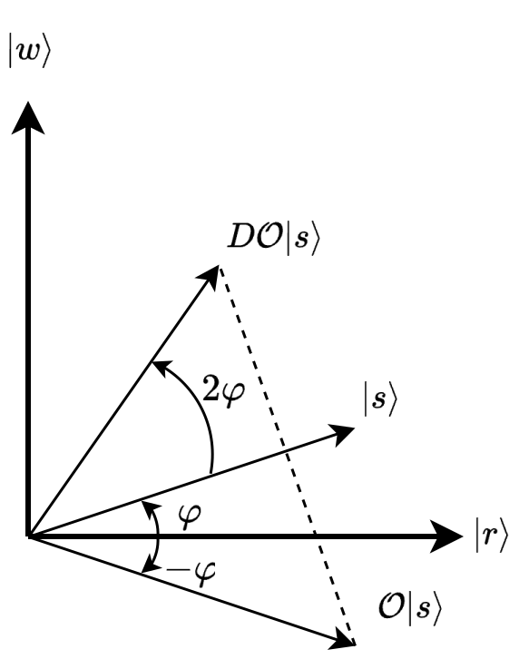

In the [previous post](/quantum-computing-part-1), we got a crash course in the relevant parts of quantum mechanics and extended classical computing to quantum computing. We defined quantum gates and looked at multi-qubit systems. Finally, we tied everything together into two applications: quantum teleportation and superdense coding. These were a good start to get a feel for how different classical and quantum computing are, albeit using slightly contrived examples.

In this post, we're going to ramp up the complexity with one of the most well-known quantum algorithms: Grover's Algorithm. I'll introduce it using an exercise and then we'll derive it by ourselves algebraically! From that algebra, we'll notice a neat geometric interpretation fall out of it that helps with the intuition. Finally, we'll build an example circuit in Qiskit noting some practicalities in implementation and run it to show that it works!

# Introduction to Grover's Algorithm

Grover's Algorithm is always pedagogically taught as an algorithm for unstructured search: suppose we have a huge unstructured set of items and we want to identify a subset of "correct" items. Classically, we need to search through every item so that puts us at $O(N)$. However Grover's Algorithm gives us a quantum speedup on this where we only need $O(\sqrt{N})$ searches due to exploiting superposition and quantum parallelism. (This is generally the theme of most quantum algorithms.) There are a number of ways to understand and interpret how it works so I'll start with a sketch of the algorithm and walking through an example. Then we'll try to effectively derive it ourselves algebraically. There's a geometric interpretation that makes more sense after we've seen the algebraic derivation. Finally we'll take the algebraic derivation and turn it into quantum gates that we can write a program for. 

Now during the process, we'll make references to an "oracle" and your immediate reaction is likely "what's the point of the algorithm if the oracle tells us the answer?" First, Grover's relies on separating the problem into (i) finding a solution and (ii) verifying a solution. In general, the latter is much easier to do than the former: if I gave you the solution to a differential equation, you could verify it works but finding that solution in the first place is much more difficult. That's what the oracle does: verifies the solution. Second, the "unstructured search" part is a good way to teach it pedagogically but a more realistic application we'll see is for boolean satisfiability, i.e., solutions to equations with many boolean variables.

The sketch of the algorithm is the following. To start, we need enough qubits to encode the problem size, e.g., a dataset of 8 items requires 3 qubits. In general, if we have N items, we need $\left\lceil\log_2 N\right\rceil$ qubits. We'll also start by initializing all qubits to $\ket{0}$.

1. Put all qubits into an even superposition with Hadamard operators.
2. Use quantum parallelism with the Oracle to flip the phase of the "correct" item.
3. Apply the Grover Diffusion Operator to amplify the phase of the correct item and dampen the phases of the incorrect items.
4. Repeat Step 2-3 a fixed number of times.
5. Measure the final state.

To go through an example, we'll need to define a few auxiliary gates. Suppose our Oracle is $f$ that returns 1 if its input is a solution and 0 otherwise. With that we can define an operator that flips the phase of a state if the state is the solution.

$$
U_f\ket{x} = (-1)^{f(x)}\ket{x}
$$

Here $x$ is the binary representation of any integer (e.g., $3$ is $\ket{11}$). To define the Grover Diffusion Operator, we need another kind of gate that flips the phase of any input that is not the zero ket. Intuitively, it's like taking the bitwise OR of every bit in the binary representation of the state and flipping the phase if the OR is true, which is every state except the zero ket. This seems very mysterious and oddly specific but its role will appear as part of the algebraic derivation.

$$
U_{\text{OR}} = 
\begin{cases}
\phantom{-}\ket{x} & x=0^n      \\
-\ket{x} & x\neq 0^n
\end{cases}
$$

Now we can define the Oracle application and Grover Diffusion Operator as $H^{\otimes n} U_{\text{OR}} H^{\otimes n} U_f$ which is sometimes called a Grover step.

Ok so now let's apply it to a two-qubit state. Suppose the solution is $\ket{01}$. So we initialize all qubits into an even superposition as part of the initial state.

$$
\ket{s_1} = \frac{1}{2}\Big( \ket{00} + \ket{01} + \ket{10} + \ket{11} \Big)
$$

Apply the Oracle which would flip the phase of $\ket{01}$ while leaving the others unchanged.

$$
\ket{s_2} = U_f\ket{s_1} = \frac{1}{2}\Big( \ket{00} - \ket{01} + \ket{10} + \ket{11} \Big)
$$

Now we apply the Grover Diffusion Operator $H^{\otimes 2} U_{\text{OR}} H^{\otimes 2}$.

$$
\begin{align*}
\ket{s_3} &= H^{\otimes 2} U_{\text{OR}} H^{\otimes 2}\ket{s_2}\\
&= H^{\otimes 2} U_{\text{OR}} H^{\otimes 2}\frac{1}{2}\Big( \ket{00} - \ket{01} + \ket{10} + \ket{11} \Big)\\
\end{align*}
$$

One useful identity is applying a multi-qubit Hadamard operator to a state.

$$
H^{\otimes n}\ket{x} = \frac{1}{\sqrt{2^n}}\sum_{y\in\left\{0,1\right\}^n} (-1)^{x\cdot y}\ket{y}
$$

where $x\cdot y$ is the bitwise dot product. I'll leave the proof exercise to the reader! We can test this out for a 2-qubit system $\ket{00}$.

$$
\begin{align*}
H^{\otimes 2}\ket{00} &= \frac{1}{\sqrt{2^2}}\sum_{y\in\left\{0,1\right\}^2} (-1)^{00\cdot y}\ket{y}\\
&= \frac{1}{2}\sum_{y\in\left\{00, 01, 10, 11\right\}} (-1)^{00\cdot y}\ket{y}\\
&= \frac{1}{2}\Big( (-1)^{00\cdot 00}\ket{00} + (-1)^{00\cdot 01}\ket{01} + (-1)^{00\cdot 10}\ket{10} + (-1)^{00\cdot 11}\ket{11}\Big)\\
&= \frac{1}{2}\Big(\ket{00} + \ket{01} + \ket{10} + \ket{11}\Big)\\
\end{align*}
$$

This produces the right result! A Hadamard operates on each qubit independently and puts the entire state into an even superposition. Let's do the same for the other basis states.

$$
\begin{align*}
H^{\otimes 2}\ket{00} &= \frac{1}{2}\Big(\ket{00} + \ket{01} + \ket{10} + \ket{11}\Big)\\
H^{\otimes 2}\ket{01} &= \frac{1}{2}\Big(\ket{00} - \ket{01} + \ket{10} - \ket{11}\Big)\\
H^{\otimes 2}\ket{10} &= \frac{1}{2}\Big(\ket{00} + \ket{01} - \ket{10} - \ket{11}\Big)\\
H^{\otimes 2}\ket{11} &= \frac{1}{2}\Big(\ket{00} - \ket{01} - \ket{10} + \ket{11}\Big)\\
\end{align*}
$$

I've arranged the Hadamard products sequentially to make it easier to see how many terms of each state we have. Since each one has a $\frac{1}{2}$, we can pull that out and add up the terms before applying $U_{\text{OR}}$.

$$
\begin{align*}
H^{\otimes 2}\ket{s_2} &= \frac{1}{4}\Big( 2\ket{00} + 2\ket{01} - 2\ket{10} + 2\ket{11} \Big)\\
&= \frac{1}{2}\Big( \ket{00} + \ket{01} - \ket{10} + \ket{11} \Big)
\end{align*}
$$

Now we apply $U_{\text{OR}}$ to flip the phase of all states except $\ket{00}$.

$$
U_{\text{OR}}H^{\otimes 2}\ket{s_2} = \frac{1}{2}\Big( \ket{00} - \ket{01} + \ket{10} - \ket{11} \Big)
$$

Then we can apply the last set of Hadamard gates. It's the same as when we applied the first set except mind the minus signs!

$$
\begin{align*}
H^{\otimes 2}U_{\text{OR}}H^{\otimes 2}\ket{s_2} &= \frac{1}{4} \Big(4\ket{01}\Big)\\
&= \ket{01}
\end{align*}
$$

We're left with the answer! In this smaller example, we only needed one Grover iteration to get the solution but this is not generally true. We'll see later an equation that tells us how many iterations we need to run for to get a high probability state.

# Algebraic Derivation

Now that we've seen an example of it working, I think it's a useful exercise to see how we can derive the algebraic representation of Grover's Algorithm rather than just having me present the solution to you. The general sketch of most quantum algorithms is to rely on superposition and function parallelism. To start, we need enough qubits to represent all indices in the "database" since the solution is going to be a binary representation of an index. Then we naturally put all of those into an even superposition and apply some function $f$ on all states at the same time. For now, let's skip past the construction of the Oracle and figure out what to do afterward. Remember we have to build a quantum circuit so we need a gate $U$ to apply after flipping the phase of the correct item.

Now the first instinct might be to design a gate $U$ such that it sets the probability of the "correct" item to 1 and the probability of all incorrect items to 0. But we can't do that since $f$ needs to act on each state independently and each "branch" can't "see" other branches. Furthermore, remember all quantum gates need to be unitary/reversible and preserve normalization. Another instinct might be to use an extra "workspace" or ancilla qubit to "record" the correct state but we run into the same problem and the ancilla qubit would have the same probability as all other states so that doesn't get us anywhere either.

So our only option is really to change the phase on the correct state since that preserves normalization and a conditional phase flip can be applied to each state independently. If we tried to "detect" that flipped phase state, yet again, we'd run into the same problem with that "detection" not being independently applied to each state. So we're resigned to only modify the phases of each state and have a state where the correct item's amplitude is flipped compared to the incorrect items.

So how do we concretely construct this gate $U$? Remember that it can't depend on the correct state and must be independent of all states so that means it must commute with every permutation of the basis states. In other words, we could relabel or shuffle the order of the states and that shouldn't change the gate. This constrains $U$ to a matrix of a specific form.

$$
U =
\begin{bmatrix}
a & b & \cdots & b \\
b & a & \cdots & b \\
\vdots & & \ddots & \vdots \\
b & \cdots & b & a
\end{bmatrix}
$$

We have one value $a$ on the diagonal and a single value $b$ for all other entries. This is the only form of a matrix that commutes for all permutations of the basis states. This effectively treats all items equally since we don't know the "correct" item and there's no reason for us to prefer one state over the other. An algebraic way to represent this form is simply $(a-b)I+bJ$ where $J$ is a matrix of all ones. So far we've been using abstract values but let's tie in where we are in Grover's Algorithm. Remember that $\ket{s_1}$ is the state that's an even superposition of all states so the amplitudes are all equal to $\frac{1}{\sqrt{N}}$. Let's simply define $\ket{s}=\ket{s_1}$ to make the equation look nice. We can construct a matrix using the outer product $\ket{s}\bra{s}$ which would be a matrix of all $\frac{1}{N}$ so $J=N\ket{s}\bra{s}$ and we've connected this matrix to Grover's using $\ket{s}$! For simplicity, we can rename $\beta=bN$ and write the form of the gate.

$$
U = \alpha I + \beta\ket{s}\bra{s}
$$

That's great! But we have two free variables we need to fix. To start, we can impose the unitary condition that $U^\dagger U=I$ which means that $U^\dagger = \bar{\alpha} I + \bar{\beta}\ket{s}\bra{s}$. Let's plug that into the identity and see what happens.

$$
\begin{align*}
U^\dagger U &= I \\
\Big(\bar{\alpha}I + \bar{\beta}\ket{s}\bra{s}\Big)\Big(\alpha I + \beta\ket{s}\bra{s}\Big) &= I \\
\bar{\alpha}\alpha I + \alpha\bar{\beta}I\ket{s}\bra{s} + \bar{\alpha}\beta I\ket{s}\bra{s} + \bar{\beta}\beta\Big(\ket{s}\bra{s}\Big)^2 &= I \\
\abs{\alpha}^2 I + \alpha\bar{\beta}I\ket{s}\bra{s} + \bar{\alpha}\beta I\ket{s}\bra{s} + \abs{\beta}^2\ket{s}\bra{s} &= I \\
\abs{\alpha}^2 I + \Big(\alpha\bar{\beta} + \bar{\alpha}\beta + \abs{\beta}^2\Big)\ket{s}\bra{s} &= I
\end{align*}
$$

In the second-to-last step, "squaring" a state doesn't do anything to it. In the last step, I grouped like terms. Now with this equation, the first term is already $I$ and the right-hand side is $I$ so the coefficient $\abs{\alpha}^2=1$ and the other coefficient $\alpha\bar{\beta} + \bar{\alpha}\beta + \abs{\beta}^2 = 0$. The first constraint is easy but let's see what we can do about the second one through some algebra.

$$
\begin{align*}
\alpha\bar{\beta} + \bar{\alpha}\beta + \abs{\beta}^2 &= 0 \\
\abs{\alpha}^2 + \alpha\bar{\beta} + \bar{\alpha}\beta + \abs{\beta}^2 &= \abs{\alpha}^2 \\
\abs{\alpha+\beta}^2 &= \abs{\alpha}^2 = 1 \\
\end{align*}
$$

In the second-to-last step, I completed the square by adding $\abs{\alpha}^2$ to both sides and factoring. Now since $\abs{\alpha}^2=1$, we can treat it as a phase and factor it out entirely from $U$ and drop it since we're always free to drop a global phase.


$$
\begin{align*}
U &= \alpha I + \beta\ket{s}\bra{s} \\
&= \alpha \Big(I + \frac{\beta}{\alpha}\ket{s}\bra{s}\Big) \\
&= I + \frac{\beta}{\alpha}\ket{s}\bra{s} \\
&= I + \gamma\ket{s}\bra{s}
\end{align*}
$$

In the last step, I've set $\gamma=\frac{\beta}{\alpha}$. However it's not a free variable since we still haven't used the fact that $\abs{\alpha + \beta}^2 = 1$. A simpler but equivalent statement is that $\abs{\alpha + \beta} = 1$ so let's use that and divide both sides by $\abs{\alpha}=1$ and bring it into the norm.

$$
\abs{1 + \gamma} = 1
$$

We can apply the same logic as we did with $\abs{\alpha} = 1$ to treat this as a phase with an offset of 1.

$$
\begin{align*}
1 + \gamma &= e^{i\phi} \\
\gamma &= e^{i\phi} - 1
\end{align*}
$$

Now we can finally substitute into $U$ and we have one free variable $\phi$ that represents a relative phase.

$$
U_\phi = I + \Big(e^{i\phi} - 1\Big)\ket{s}\bra{s}
$$

We've removed all free params except a phase $\phi$! Now we need to fix $\phi$ somehow. Remember that the entire point of $U$ is to find a way to amplify and select the correct item. In other words, after we apply $U_\phi$ to a state, it should give more probability to the correct item. Let's start by simply applying it to some arbitrary state $\psi$.

$$
\begin{align*}
U_\phi\ket{\psi} &= I\ket{\psi} + \Big(e^{i\phi} - 1\Big)\ket{s}\braket{s|\psi} \\
&= \ket{\psi} + \Big(e^{i\phi} - 1\Big)\ket{s}\braket{s|\psi}
\end{align*}
$$

The identity operator leaves the state unchanged but we have $\braket{s\vert\psi}$ that we need to expand. This is an inner product that results in just a number. We take the inner product of the coefficients remembering that all coefficients of $\ket{s}$ are the same $\frac{1}{\sqrt{N}}$ and the coefficients of $\psi$ are just $\psi_i$.

$$
\begin{align*}
\braket{s|\psi} &= \frac{1}{\sqrt{N}}\psi_1 + \cdots + \frac{1}{\sqrt{N}}\psi_N \\
&= \frac{1}{\sqrt{N}}\sum_i\psi_i \\
\end{align*}
$$

Now let's expand $\ket{s}=\frac{1}{\sqrt{N}}\sum_x\ket{x}$ since it's an even superposition across all states and get the full term.

$$
\begin{align*}
\ket{s}\braket{s|\psi} &= \frac{1}{\sqrt{N}}\sum_x\ket{x}\Bigg(\frac{1}{\sqrt{N}}\sum_i\psi_i\Bigg) \\
&= \underbrace{\Bigg(\frac{1}{N}\sum_i\psi_i\Bigg)}_{\text{mean of }\ket{\psi}}\sum_x\ket{x} \\
&= m\sum_x\ket{x} \\
\end{align*}
$$

Notice that something fun appears during the expansion: the mean of $\ket{\psi}$! And it's the same for each state $\ket{x}$. So intuitively, we can think of the term $\ket{s}\braket{s\vert\psi}$ as a state where each amplitude is the mean of $\ket{\psi}$. Before we substitute that result back into $U_\phi$, since $\ket{\psi}$ is arbitrary and the $\ket{x}$ form an orthonormal basis, we can represent $\ket{\psi}$ in that basis with coefficients $\psi_x$.

$$
\begin{align*}
U_\phi\ket{\psi} &= \ket{\psi} + \Big(e^{i\phi} - 1\Big)\ket{s}\braket{s|\psi} \\
&= \ket{\psi} + \Big(e^{i\phi} - 1\Big)m\sum_x\ket{x} \\
&= \sum_x\psi_x\ket{x} + \Big(e^{i\phi} - 1\Big)m\sum_x\ket{x} \\
&= \sum_x\Bigg[\psi_x + \Big(e^{i\phi} - 1\Big)m\Bigg]\ket{x} \\
\end{align*}
$$

So we can think of $U_\phi$ as adding the same $(e^{i\phi} - 1)m$ to each amplitude of $\ket{\psi}$. Let's apply this shift to both the correct state's amplitude $a_\text{correct}$ and incorrect states' amplitudes $a_\text{incorrect}$ keeping in mind that the amplitude of the correct and incorrect states are $-\frac{1}{\sqrt{N}}$ and $\frac{1}{\sqrt{N}}$ respectively.

$$
\begin{align*}
a_\text{correct} &= -\frac{1}{\sqrt{N}} + \Big(e^{i\phi} - 1\Big)m \\
a_\text{incorrect} &= \frac{1}{\sqrt{N}} + \Big(e^{i\phi} - 1\Big)m
\end{align*}
$$

Now we need to pick $\phi$ such that it's as large as possible and in the right direction to separate the correct from the incorrect items. In other words, we need to select $\phi$ such that $(e^{i\phi} - 1)m$ is as negative as possible. Since $e^{i\phi}=\cos\phi + i\sin\phi$ is a phase on the unit circle, the largest negative value it can take is -1 that happens when $\phi=\pi$ which would make $(e^{i\phi} - 1)m = -2m$.

Let's substitute that back into $U_\phi\ket{\psi}$.

$$
\begin{align*}
U_\phi\ket{\psi} &= \ket{\psi} + \Big(e^{i\phi} - 1\Big)\ket{s}\braket{s|\psi} \\
U_\phi\ket{\psi} &= \ket{\psi} -2\ket{s}\braket{s|\psi} \\
\end{align*}
$$

Our choice of $\ket{\psi}$ was arbitrary so we can factor out $\ket{\psi}$.

$$
U = I - 2\ket{s}\bra{s}
$$

This is the Grover Diffusion Operator $D$! We derived it algebraically from scratch! One thing to note is that you might see this written as $U = 2\ket{s}\bra{s} - I$ sometimes but they're equivalent statements up to a global phase of -1.

Now to illustrate that the algebraic derivation gives us the right answer, let's go through the same example we did at the start but with actual equations and a proper set of operators.

But before that, one quick thing that's still a loose end is how to represent the Oracle as an operator. As it turns out, we can re-use the form for the Grover Diffusion Operator to compute the oracle. In other words, we can represent the phase flip of the oracle in a similar form. To see this, let's consider the same $\ket{\psi} = \sum_x \psi_x\ket{x}$ and the phase of the element we want to flip is $\psi_w$. We can represent $w$ as a state $\ket{w}$ too that represents the "correct" state we want and the inner product $\braket{w\vert\psi}=\psi_w$ can be thought of as a way to "select" the element $w$ from the $\ket{\psi}$ state. Then we can multiply it with the state $\ket{w}$ in the same way: $\ket{w}\braket{w\vert\psi}=\psi_w\ket{w}$. This intuitively "selects" the right amplitude $\psi_w$ from $\ket{\psi}$. Now we can subtract two copies of that from the original $\ket{\psi}$: once to remove it and again to negate it so the term looks like.

$$
\begin{align*}
\ket{\psi} - 2\psi_w\ket{w} &= \ket{\psi} - 2\ket{w}\braket{w|\psi} \\
&= \Big(I-2\ket{w}\bra{w}\Big)\ket{\psi} \\
\end{align*}
$$

Since the choice of $\ket{\psi}$ was arbitrary, we can remove it and we get that the Oracle operator can be represented algebraically.

$$
\mathcal{O} = I - 2\ket{w}\bra{w}
$$ 

Ok now we're finally ready to walk through the algebraic steps of Grover's Algorithm! To start, just as before, we need enough qubits to represent all items in the first place and they all need to be initialized to $\ket{0}$.

0. Initialize all qubits to $\ket{0}$.
1. Apply $H^{\otimes n}$ to put all qubits into an even superposition.
2. Apply the Oracle $\mathcal{O} = I - 2\ket{w}\bra{w}$ to flip the phase of the "correct" item
3. Apply the Grover Diffusion Operator $D = 2\ket{s}\bra{s} - I$ to amplify the phase of the correct state.
4. Repeat Step 2-3 a fixed number of times $k$ to end up with a total state of $(D\mathcal{O})^k\ket{s}$.
5. Measure the final state.

Ok now let's walk through the 2-qubit example with this specific algorithm where the solution is $\ket{01}$. So the initial state is $\ket{s_0}=\ket{00}$. Applying the Hadamard puts us in an even superposition.

$$
\ket{s_1} = H^{\otimes 2}\ket{00} = \frac{1}{2}\Big(\ket{00} + \ket{01} + \ket{10} + \ket{11}\Big)
$$

Next step is to apply the Oracle $\mathcal{O} = I - 2\ket{w}\bra{w}$.

$$
\begin{align*}
\ket{s_2} &= \mathcal{O}\ket{s_1} \\
&= \Big(I - 2\ket{w}\bra{w}\Big)\ket{s_1} \\
&= \ket{s_1} - 2\ket{w}\braket{w|s_1} \\
&= \ket{s_1} - 2\ket{w}\frac{1}{2} \\
&= \ket{s_1} - \ket{w} \\
&= \frac{1}{2}\Big(\ket{00} + \ket{01} + \ket{10} + \ket{11}\Big) - \ket{01} \\
\ket{s_2} &= \frac{1}{2}\Big(\ket{00} - \ket{01} + \ket{10} + \ket{11}\Big) \\
\end{align*}
$$

Now we can apply the Grover Diffusion Operator $D = 2\ket{s}\bra{s} - I$ with $s=s_1$, i.e., the even superposition.

$$
\begin{align*}
\ket{s_3} &= D\ket{s_2} \\
&= \Big(2\ket{s_1}\bra{s_1} - I\Big)\ket{s_2} \\
&= 2\ket{s_1}\braket{s_1|s_2} - \ket{s_2}
\end{align*}
$$

We need to compute the inner product $\braket{s_1\vert s_2}$.

$$
\begin{align*}
\braket{s_1|s_2} &= \frac{1}{2}\Big(\bra{00} + \bra{01} + \bra{10} + \bra{11}\Big)\frac{1}{2}\Big(\ket{00} - \ket{01} + \ket{10} + \ket{11}\Big) \\ 
&= \frac{1}{4}(1 - 1 + 1 + 1) \\
&= \frac{1}{2}
\end{align*}
$$

Remember that for an inner product, we're just looking at same indices, not all of the cross terms. Great now let's substitute that inner product back in.

$$
\begin{align*}
\ket{s_3} &= 2\ket{s_1}\braket{s_1|s_2} - \ket{s_2} \\
&= 2\ket{s_1}\frac{1}{2} - \ket{s_2} \\
&= \ket{s_1} - \ket{s_2} \\
&= \frac{1}{2}\Big(\ket{00} + \ket{01} + \ket{10} + \ket{11}\Big) - \frac{1}{2}\Big(\ket{00} - \ket{01} + \ket{10} + \ket{11}\Big) \\
&= \frac{1}{2}\Big(2\ket{01}\Big)\\
&= \ket{01}\\
\end{align*}
$$

We get the exact solution in just one iteration! This specific problem gives us a solution in one step but, in general, we'd need to run for a number of steps but not too many steps! To better derive the number of steps, we'll need to build a geometric picture of the algorithm.

# Geometric Intuition

Now that we understand the algebra, we can construct the geometric picture of Grover's Algorithm for more intuition especially on the optimal number of steps to run for. We can visualize Grover's Algorithm as the motion of a vector on a plane. The core intuition is that we can construct a new orthogonal basis from the correct and incorrect states. Note that this is an orthogonal basis since a state is either correct or not. Let's call the correct state $\ket{w}$ and the rest of the states $\ket{r}=\frac{1}{\sqrt{N-1}}\sum_{x\neq w}\ket{x}$. Now the starting state $\ket{s_1}$ lives in this plane.

$$
\ket{s_1} = \frac{1}{\sqrt{N}}\ket{w} + \sqrt{\frac{N-1}{N}}\ket{r}
$$

Since it's a vector in a plane, we can also represent it by a rotation $\theta$ from $\ket{r}$ such that $\sin\theta=\frac{1}{\sqrt{N}}$ since it's the projection of the even superposition, and we can describe all operations of Grover's Algorithm as how we move this vector in the plane and equivalently think about it as rotations in that plane.

Remember we first apply the Oracle which flips the phase of the correct state.

$$
\ket{s_2} = -\frac{1}{\sqrt{N}}\ket{w} + \sqrt{\frac{N-1}{N}}\ket{r}
$$

Geometrically, this is equivalent to reflecting the state over the $\ket{r}$ axis since we negate the coefficient of that term. So if we were at $\theta$ before, we're now at $-\theta$.



<small>Grover's Algorithm can be represented as a vector moving on a plane spanned by correct $\ket{w}$ and incorrect $\ket{r}$ solutions. The vector forms an angle $\varphi$ that we manipulate using the Oracle and diffusion operators to get the angle as close to $\frac{\pi}{2}$ as possible and hence as "aligned" as possible with the correct solution $\ket{w}$.</small>


Now the Grover Diffusion operation can be thought of as reflecting $\ket{s_2}$ about $\ket{s_1}$ and to see this, we can split $\ket{s_2}$ into two orthogonal parts: the part parallel to $\ket{s_1}$ and the part perpendicular to $\ket{s_1}$. The parallel part is simply the projection of $\ket{s_2}$ onto $\ket{s_1}$. From geometry, to project a vector $u$ onto a vector $v$, that's simply the dot product times the vector you want to project onto $u^Tv~v$, almost like the "percentage" of $u$ along $v$. Here we use states but it's the exact same concept: the parallel part is $\braket{s_1\vert s_2}\ket{s_1}$. After we have the parallel part, the perpendicular part is simply the full vector minus the parallel part: $\ket{s_2} - \braket{s_1\vert s_2}\ket{s_1}$. Ok keep that in mind and let's apply the Grover Diffusion operator $D = 2\ket{s}\bra{s} - I$ ($s=s_1$).

$$
\begin{align*}
D\ket{s_2} &= 2\ket{s_1}\braket{s_1|s_2} - \ket{s_2} \\
&= \ket{s_1}\braket{s_1|s_2} + \ket{s_1}\braket{s_1|s_2} - \ket{s_2} \\
&= \braket{s_1|s_2}\ket{s_1} + \braket{s_1|s_2}\ket{s_1} - \ket{s_2} \\
&= \braket{s_1|s_2}\ket{s_1} - \Big(\ket{s_2} - \braket{s_1|s_2}\ket{s_1} \Big) \\
D\ket{s_2} &= \underbrace{\braket{s_1|s_2}\ket{s_1}}_{\parallel} - \underbrace{\Big(\ket{s_2} - \braket{s_1|s_2}\ket{s_1} \Big)}_{\perp} \\
\end{align*}
$$

That looks just the parallel part of $\ket{s_2}$ plus the negative of the perpendicular part of $\ket{s_2}$! Note that the parallel part is unchanged but the perpendicular part is negated so we can geometrically interpret that as flipping or reflecting $\ket{s_2}$ over the $\ket{s_1}$ state. Since $\ket{s_2}$ is $\theta - (-\theta) = 2\theta$ away from $\ket{s_1}$, the reflection puts us $2\theta$ past $\ket{s_1}$ and $3\theta$ past $\ket{r}$. So each iteration of Grover's Algorithm rotates us $2\theta$ towards $\ket{w}$.

Now this revelation tells us how many times we should run Grover's Algorithm and that running too many iterations would put us *beyond* $\ket{w}$ and we'd have to cycle around again. We can think of the final vector's angle as a function of the number of iterations $(2k + 1)\theta$ for $k\in\mathbb{N}$. Now the projection of that onto the $\ket{w}$ axis just taking the sine of the angle $\sin\big[(2k+1)\theta\big]$. Remember that the probability of ending up in a state is the squared norm and $\ket{w}$ is at $\frac{\pi}{2}$. For a unit vector with an angle $\varphi$, its component along the $\ket{w}$ axis is $\sin\varphi$. So the probability of Grover's Algorithm ending in success is $\sin^2\big[(2k+1)\theta\big]$. We want the argument of the sine to be $\frac{\pi}{2}$ since the angle of $\ket{w}$ is $\frac{\pi}{2}$.

$$
\begin{align*}
(2k + 1)\theta &= \frac{\pi}{2} \\
k &= \frac{\pi}{4\theta} - \frac{1}{2} \\
\end{align*}
$$

For very large N, $\theta$ is small and hence $\theta\approx\frac{1}{\sqrt{N}}$.

$$
k\approx\frac{\pi}{4}\sqrt{N}
$$

Hence the optimal number of iterations is to round $k$ so that the final angle ends up within $\pm\theta$ of $\frac{\pi}{2}$. Usually no whole number is going to land on exactly $\frac{\pi}{2}$ but we won't be any farther away than half of the spacing $2\theta$. Since $\sin^2\varphi$ is largest at $\frac{\pi}{2}$ and symmetric, in the worst case, we're basically at exactly $\frac{\pi}{2}-\theta$. Hence, the success probability is *at least* $\sin^2(\frac{\pi}{2} - \theta) = \cos^2\theta = 1 - \sin^2\theta = 1 - \frac{1}{N}$ (since $\sin\theta = \frac{1}{\sqrt{N}}$) taking that worst-case into consideration. This also explains why running Grover's Algorithm for too many iterations means we miss the $\frac{\pi}{2}$ and have to keep iterating until we wrap back around so the probability is high.

So far, we've been talking about Grover's Algorithm producing a single solution but it's actually fairly simple to extend it to multiple $M$ solutions. The first change is that $\ket{w}$ is no longer a single solution but a superposition of all solutions and $\ket{r}$ still represents the non-solutions.

$$
\begin{align*}
\ket{w} &= \frac{1}{\sqrt{M}} \sum_{x_{\text{correct}}} \ket{x} \\
\ket{r} &= \frac{1}{\sqrt{N-M}} \sum_{x_{\text{incorrect}}} \ket{x} \\
\end{align*}
$$

This also means that in the first superposition, each of the $M$ correct states has an amplitude $\frac{1}{\sqrt{N}}$ so we sum those all up.

$$
\ket{s_1} = \sqrt{\frac{M}{N}}\ket{w} + \sqrt{\frac{N-M}{N}}\ket{r}
$$

This means our $\theta$ changes to satisfy $\sin\theta=\sqrt{\frac{M}{N}}$. This makes sense since more solutions means we start closer to $\ket{w}$ since there's a higher chance to find a correct solution. The other dependent equations that update are also $k\approx\frac{\pi}{4}\sqrt{\frac{N}{M}}$ and the success probability is now $\geq 1-\frac{M}{N}$. Besides those, everything else we've spoken about stays the same!

There's one big practicality in finding the ideal number of iterations: it depends on knowing the number of solutions. We can't practically know this but there's some previous research that can help us. [*Tight bounds on quantum searching* by Boyer et al (1996)](https://arxiv.org/pdf/quant-ph/9605034) leverages the fact that checking a solution is cheap so they assume a value of $k$, run Grover's Algorithm, and check the result against the function. The sketch of their algorithm starts with randomly sampling $k\in [0, m)$ with an upper bound $m$ on the number of iterations, initially just $m=1$ and check the solutions from that. The random sample is more effective since the success probability is a sinusoidal function so it oscillates; hence doing a straight linear search $k=0,1,2,\cdots$ would cost the same as a classical search and keep us landing in the valleys so a random $k$ effectively "averages" that success over the oscillation. Then they grow $m$ proportionally by some scale factor $\lambda$ that grows $m$ up to $\sqrt{N}$ and re-run. I'll leave that paper as an exercise to the reader but it's a sneak peek into moving beyond Grover's Algorithm as a learning exercise and towards using it more practically.

# Quantum Circuit

Ok now that we've discussed the theory, both algebraically and geometrically, we can finally build a quantum circuit that represents Grover's algorithm we can actually run. We're going to translate each step of Grover's Algorithm into a set of gates and build that incrementally using Qiskit.

Before we build the circuit, let's finally address the Oracle. So far, we've been progressing with understanding Grover's Algorithm with an oracle that flips the phase of the correct state. Of course this is pointless for the use-case of "unstructured search" since we have to know the correct state to construct the Oracle which defeats the purpose of the search! A more practical use of Grover is using it to solve classical computer science problems like Boolean satisfiability, AES encryption key search, and subset sum. Fortunately these kinds of problems are everywhere and many real-world scenarios can be reduced to these kinds of problem.

We'll be using a SAT problem as the more practical example. In a 3-SAT problem, we have a function $f$ of a number of clauses of 3 literals (with however many number of total variables $n$) and we want to find sets of inputs to those variables that make $f$ true. An example is a function $f(x_1, x_2, x_3, x_4) = (x_1 \lor x_2 \lor \lnot x_3) \land (\lnot x_2 \lor x_3 \lor \lnot x_4)$. One practical application that can be formulated as a SAT problem is vehicle routing. This is an NPC (NP-Complete) problem in that there is no known classical algorithm that can solve this in polynomial time. The naive approach would be to test all possible combinations so that would be $2^n$ tries. We can be more clever if we know the structure of $f$ a-priori but Grover's Algorithm can give us a solution by just blindly implementing $f$ as a quantum circuit. Specifically, Grover's Algorithm turns the $2^n$ into $2^{\frac{n}{2}}$ and is hence a quadratic speedup. Note this does *not* solve NPC problems efficiently.

The connection between the Oracle that we've discussed so far and this new function $f$ is that the Oracle is just a criterion: $\mathcal{O}\ket{x}=(-1)^{f(x)}\ket{x}$. Any set of gates that satisfies this relation can be called an Oracle that we can use in Grover's Algorithm. SAT functions are one specific kind of function that can be implemented with quantum gates to satisfy that criterion. This is a much more practical use of Grover's Algorithm! We can implement $f$ such that it satisfies the criterion for being an Oracle even though we don't know the right combination of inputs to make $f$ true!

Let's illustrate with a slightly more complicated 2-SAT example. While 2-SAT *is* something that's efficiently solvable classically, it keeps the example circuit small and everything about the Oracle construction is identical for more complicated SAT problems.

$$
f(a, b, c) = (a \lor b) \land (\lnot b \lor c) \land (\lnot a \lor c) \land (\lnot b \lor \lnot c)
$$

Read through it carefully. We can use some logic and determine that only one solution exists: $(a,b,c)=(1,0,1)$. We can take that function and implement that as a sequence of quantum gates. The gates in our palette are the X/NOT, AND/Toffoli, and CNOT gates. Notice we need an OR too but we can use De Morgan's Law to transform an OR into NOTs and ANDs: $a \lor b = \lnot (\lnot a \land \lnot b)$.

Now we can implement that with our existing palette. We have 3 qubits (A, B, C) and 4 OR clauses (C1, C2, C3, C4) that we can combine. We can print out that circuit and name the qubits.

```
         ┌───┐     ┌───┐                                   
      a: ┤ X ├──■──┤ X ├─────────────────■─────────────────
         ├───┤  │  ├───┤                 │                 
      b: ┤ X ├──■──┤ X ├──■──────────────┼─────────■───────
         ├───┤  │  └───┘  │  ┌───┐┌───┐  │  ┌───┐  │       
      c: ┤ X ├──┼─────────■──┤ X ├┤ X ├──■──┤ X ├──■───────
         └───┘┌─┴─┐┌───┐  │  └───┘└───┘  │  └───┘  │       
  a ∨ b: ─────┤ X ├┤ X ├──┼──────────────┼─────────┼───────
              └───┘└───┘┌─┴─┐┌───┐       │         │       
 ~b ∨ c: ───────────────┤ X ├┤ X ├───────┼─────────┼───────
                        └───┘└───┘     ┌─┴─┐┌───┐  │       
 ~a ∨ c: ──────────────────────────────┤ X ├┤ X ├──┼───────
                                       └───┘└───┘┌─┴─┐┌───┐
~b ∨ ~c: ────────────────────────────────────────┤ X ├┤ X ├
                                                 └───┘└───┘
    out: ──────────────────────────────────────────────────
```

Now we can't just substitute this in for the Oracle on its own. Remember that the criterion for the Oracle is $\mathcal{O}\ket{x}=(-1)^{f(x)}\ket{x}$ and nothing in this circuit we've constructed satisfies that. We need to first compute $f$ and then conditionally flip the phase of the input state if $f$ is true. At this point we know we'll need an ancilla qubit to write the value of $f$ since we can't just overwrite $\ket{x}\rightarrow\ket{f(x)}$. Instead, we'll have an input $\ket{x}\ket{0}$ that gets mapped to $\ket{x}\ket{f(x)}$ so the operation is unitary. Now we have $f$ recorded as part of the state and we can apply a Z gate to $\ket{f(x)}$ since $Z\ket{a}\rightarrow (-1)^a\ket{a}$ so we get $(-1)^{f(x)}\ket{x}\ket{f(x)}$.

At this stage we might think we're done! But let's actually try to apply this in context. Remember that the input to the Oracle is an even superposition, at least to start.

$$
\ket{s}\ket{0} = \frac{1}{\sqrt{N}}\sum_x\ket{x}\ket{0}
$$

Applying the Oracle, we get the result of $f(x)$ in the ancilla.

$$
\frac{1}{\sqrt{N}}\sum_x\ket{x}\ket{f(x)}
$$

Then applying a Z gate we get the phase.

$$
\frac{1}{\sqrt{N}}\sum_x (-1)^{f(x)}\ket{x}\ket{f(x)}
$$

Let's expand that superposition.

$$
\frac{1}{\sqrt{N}}\Bigg(\sum_{x:f(x)=0} \ket{x}\ket{0} - \sum_{x:f(x)=1} \ket{x}\ket{1}\Bigg)
$$

This split is a problem since the next step is the Grover Diffusion Operator. However, we've just split the state into two orthogonal parts (since an item can't be correct and incorrect)! Since this is a sum, the operator acts independently on each term so they can never interfere.

If that last term's $\ket{1}$ was a $\ket{0}$, then we could factor out the ancilla and the state would look like.

$$
\frac{1}{\sqrt{N}}\Bigg(\sum_x (-1)^{f(x)}\ket{x}\Bigg)\ket{0}
$$

Then diffusion would see the positive and negative phases in a single state. So we effectively need to get $\ket{f(x)}$ back to $\ket{0}$. We can't just "reset" the qubit since measurement isn't unitary. Fortunately since $f(x)$ is represented by a set of gates $U_f$, it must be unitary and all unitaries are reversible! So we just need to "uncompute" $f$ by applying the gates in reverse! So the act of applying $f$ is really three parts: apply $U_f$ to write $f$ into the ancilla $\ket{0}$, apply $Z$, and apply $U_f^\dagger$ to uncompute $\ket{f(x)}$ back to $\ket{0}$!

There's one trick we can use to shorten the number of parts: **phase kickback**. Rather than using $\ket{0}$ as the ancilla, use $\ket{-}=\frac{\ket{0}-\ket{1}}{\sqrt{2}}$ instead. The reason for this is if we were to XOR a bit (i.e., controlled X gate), then the state $\ket{-}$ is preserved but with a phase if the bit is 1: $(-1)^b\ket{-}$. This is perfect for $f(x)$ and means we don't have to apply $Z$ or uncompute $f(x)$ since the state would be unchanged anyways! However we do need to uncompute any scratch qubits we use besides the ancilla since only the ancilla has that property. For the example above, we have 4 scratch qubits that we need to uncompute but not the ancilla if it's in $\ket{-}$. In fact, we don't need the ancilla to be exactly in $\ket{0}$, we just need it to be in the same state before and after the Oracle so we can factor that same state out.

Ok now let's recap the algorithm and then turn it into gates with the SAT problem in mind.

0. Initialize all data and clause qubits to $\ket{0}$ and the output ancilla qubit to $\ket{-}$.
1. Apply $H^{\otimes n}$ to all data qubits to put them into an even superposition.
2. Apply the Oracle $\mathcal{O} = I - 2\ket{w}\bra{w}$ to flip the phase of the "correct" item
3. Apply the Grover Diffusion Operator $D = 2\ket{s}\bra{s} - I$ to amplify the phase of the correct state.
4. Repeat Step 2-3 a fixed number of times $k$ to end up with a total state of $(D\mathcal{O})^k\ket{s}$.
5. Measure the final state.

Step 0 is the easiest since we already initialize our qubits in $\ket{0}$. The next step with Hadamard is to just apply Hadamard to every data qubit. 

Applying the Oracle is exactly what we just spoke about: we need some scratch qubits to compute $f$ and the ancilla in $\ket{-}$ (apply $HX\ket{0}$).

Now we need to translate the Grover Diffusion Operator $D = 2\ket{s}\bra{s} - I$ into gates. The trickiest part is the $\ket{s}\bra{s}$ part since that doesn't intuitively map to something that's directly cleanly represented by a state. But remember that $\ket{s}$ is just an even superposition so we can do the "apply an operator and its inverse together" trick sandwiching $\ket{0\cdots 0}$ in between $H^{\otimes n}$ and its inverse, which is also $H^{\otimes n}$.

$$
\begin{align*}
D &= 2\ket{s}\bra{s} - I \\
&= H^{\otimes n}\Big(2\ket{0\cdots 0}\bra{0\cdots 0} - I\Big)H^{\otimes n}
\end{align*}
$$

We also used the identity that $HIH=I$ so verify for yourself that these two equations are equivalent. To make this look like something we've seen before, I'll factor out a global phase of $-1$.

$$
H^{\otimes n}\Big(I - 2\ket{0\cdots 0}\bra{0\cdots 0}\Big)H^{\otimes n}
$$

Now the inner part looks just like our Oracle! In this form, we can think of the Diffusion operator as flipping the sign of just the $\ket{0\cdots 0}$ state. This is similar to a multi-controlled Z gate $C^{n-1}Z$ ($n-1$ since the last qubit is where we apply the Z gate). Remember the controlled Z gate flips the phase if the input is 1. However, we want to flip the phase if the input is 0 but we can sandwich the controlled Z between X gates (remember X is also its own inverse) to get it to apply to 0 instead of 1.

Ok so putting everything together, the Diffusion operator can be represented by a multi-controlled Z gate sandwiched between X and H gates.

$$
D = H^{\otimes n}X^{\otimes n}C^{n-1}ZX^{\otimes n}H^{\otimes n}
$$

This is equivalent up to a global phase of -1 and something we can implement in gates! So now the version of Grover's Algorithm that we can implement in gates looks like the following.

0. Initialize all qubits to $\ket{0}$ and the ancilla to $\ket{-}$.
1. Apply $H^{\otimes n}$ to put all data qubits into an even superposition.
2. Apply the Oracle $U_f\frac{1}{\sqrt{N}}\sum_x \ket{x}\ket{-}=\frac{1}{\sqrt{N}}\sum_x (-1)^{f(x)}\ket{x}\ket{-}$ to flip the phase of the "correct" item
3. Apply the Grover Diffusion Operator $D = H^{\otimes n}X^{\otimes n}C^{n-1}ZX^{\otimes n}H^{\otimes n}$ to amplify the phase of the correct state.
4. Repeat Step 2-3 a fixed number of times $k$
5. Measure the final state.

# Code Implementation

Now that we've discussed the algebra, geometry, and gates of Grover's Algorithm, it's time to implement it using Qiskit! We're going to start by defining constants such as the qubit indices and names.

```python
import math

from qiskit import ClassicalRegister, QuantumCircuit, QuantumRegister
from qiskit.primitives import StatevectorSampler

A, B, C = 0, 1, 2
# clause qubits
C1, C2, C3, C4 = 3, 4, 5, 6
OUT = 7

QUBIT_NAMES = ["a", "b", "c", "a ∨ b", "~b ∨ c", "~a ∨ c", "~b ∨ ~c", "out"]
QREGS = [QuantumRegister(1, name) for name in QUBIT_NAMES]
N_VARS = 3
```

I've explicitly created registers for each with their names so the circuit is more readable. Now we can start writing the `main` by computing how many iterations we need to run Grover's for. You can implement the aforementioned paper's algorithm to solve for $k$ but, for our sake, we'll just assume we know our SAT function has only one solution.

```python
def main() -> None:
    # cheating a little and we know there is only 1 solution to this problem
    num_states, num_solutions = 2**N_VARS, 1
    theta = math.asin(math.sqrt(num_solutions / num_states))
    k = round(math.pi / (4 * theta) - 0.5)
    print(f"theta = {theta:.3f}, iterations k = {k}")
    print(f"predicted success = sin^2((2k + 1) theta) = {math.sin((2 * k + 1) * theta) ** 2:.3f}")
```

For the sake of visualization, let's see what the (gate representation of) $f$ looks like, the full Oracle, and the Diffusion operator.

```python
def main() -> None:
    ...
    # Draw each circuit
    print("\nU_f")
    print(f().draw(output="text"))
    print("\nOracle")
    print(oracle().draw(output="text"))
    print("\nDiffusion")
    print(diffusion().draw(output="text", idle_wires=False))
```

Each of these are functions that we'll define that return a `QuantumCircuit`. Now we can construct and draw the full Grover's Algorithm circuit.

```python
def main() -> None:
    ...
    qc = grover(k)
    print(f"\nFull circuit with k = {k}")
    print(qc.draw(output="text"))
    print("\n")
```

We need the number of iterations to copy the Oracle+Diffusion subcircuit. Finally we can build and run the circuit!

```python
def main() -> None:
    ...
    shots = 2 ** 10
    result = StatevectorSampler(seed=42).run([qc], shots=shots).result()
    counts = result[0].data.meas.get_counts()
    print(f"measured counts (abc, {shots} shots):")
    for bits, count in sorted(counts.items(), key=lambda kv: -kv[1]):
        # reverse the order for readability since Qiskit uses reverse bit order
        print(f"  {bits[::-1]}: {count}")
    successes = sum(count for bits, count in counts.items() if is_solution(bits[::-1]))
    print(f"measured success = {successes / shots:.3f}")
```

To measure the success rate, we check each measured result against $f$ classically. This is the cheap "verify a solution" half of the problem from the start of the post.

```python
def is_solution(abc: str) -> bool:
    # verifying a candidate is cheap: just evaluate f classically
    a, b, c = (bit == "1" for bit in abc)
    return (a or b) and (not b or c) and (not a or c) and (not b or not c)
```

Now there are 4 core functions we need to implement, `f()`, `oracle()`, `diffusion()`, and `grover(k: int)`, plus the `is_solution()` check above. For convenience, we'll have a helper function that creates an empty quantum circuit with the qubits named.

```python
def new_circuit(name: str, measure: bool = False) -> QuantumCircuit:
    cregs = [ClassicalRegister(N_VARS, "meas")] if measure else []
    return QuantumCircuit(*QREGS, *cregs, name=name)
```

Ok now we can implement our mathematical function $f$ as `f()` in terms of quantum gates. Remember we have four OR clauses so we'll write to those and also remember that we need to use De Morgan's Law to do an OR operation.

```python
def f() -> QuantumCircuit:
    qc = new_circuit("U_f")

    # C1 = a or b = not (not a and not b)
    qc.x([A, B])
    qc.ccx(A, B, C1)
    qc.x(C1)
    # remember to undo A, B!
    qc.x([A, B])

    # C2 = not b or c = not (b and not c)
    qc.x(C)
    qc.ccx(B, C, C2)
    qc.x(C2)
    # remember to undo C!
    qc.x(C)

    # C3 = not a or c = not (a and not c)
    qc.x(C)
    qc.ccx(A, C, C3)
    qc.x(C3)
    # remember to undo C!
    qc.x(C)

    # C4 = not b or not c = not (b and c)
    qc.ccx(B, C, C4)
    qc.x(C4)

    return qc
```

We're computing the NOT of qubits in-place so we need to remember to "undo" it so all input qubits are left in their original states.

```python
def oracle() -> QuantumCircuit:
    f_x = f()

    qc = new_circuit("oracle")
    # compute f
    qc.compose(f_x, inplace=True)
    qc.barrier(label="compute")

    # AND the clauses together into the output ancilla
    qc.mcx([C1, C2, C3, C4], OUT)
    qc.barrier(label="kickback")

    # remember to uncompute the clauses!
    qc.compose(f_x.inverse(), inplace=True)
    qc.barrier(label="uncompute")
    return qc
```

I've created named barriers to make it easier to identify circuit components. The next part of the circuit to implement is the diffusion operator. Since we only have 3 data qubits, the $C^{n-1}Z$ is a doubly-controlled Z gate, which Qiskit conveniently provides.

```python
def diffusion() -> QuantumCircuit:
    qc = new_circuit("diffusion")
    qc.h([A, B, C])
    qc.x([A, B, C])

    qc.ccz(A, B, C)

    qc.x([A, B, C])
    qc.h([A, B, C])
    return qc
```

The final function to implement is `grover()`. Remember to put the output ancilla in $\ket{-}$! By default, Qiskit initializes all qubits in $\ket{0}$ so we don't have to worry about that being explicit.

```python
def grover(k: int) -> QuantumCircuit:
    qc = new_circuit("grovers", measure=True)

    # even superposition over the data qubits
    qc.h([A, B, C])
    # remember to put the output ancilla in |-> = HX|0>.
    qc.x(OUT)
    qc.h(OUT)
    qc.barrier()

    # run the oracle+diffusion combination k times
    for _ in range(k):
        qc.compose(oracle(), wrap=True, inplace=True)
        qc.compose(diffusion(), wrap=True, inplace=True)
        qc.barrier()

    # measure a, b, c into classical registers
    qc.measure([A, B, C], range(N_VARS))
    return qc
```

And we're done! We can run this all together with the `main` function and see the results!

```
theta = 0.361, iterations k = 2
predicted success = sin^2((2k + 1) theta) = 0.945

U_f
         ┌───┐     ┌───┐                                   
      a: ┤ X ├──■──┤ X ├─────────────────■─────────────────
         ├───┤  │  ├───┤                 │                 
      b: ┤ X ├──■──┤ X ├──■──────────────┼─────────■───────
         ├───┤  │  └───┘  │  ┌───┐┌───┐  │  ┌───┐  │       
      c: ┤ X ├──┼─────────■──┤ X ├┤ X ├──■──┤ X ├──■───────
         └───┘┌─┴─┐┌───┐  │  └───┘└───┘  │  └───┘  │       
  a ∨ b: ─────┤ X ├┤ X ├──┼──────────────┼─────────┼───────
              └───┘└───┘┌─┴─┐┌───┐       │         │       
 ~b ∨ c: ───────────────┤ X ├┤ X ├───────┼─────────┼───────
                        └───┘└───┘     ┌─┴─┐┌───┐  │       
 ~a ∨ c: ──────────────────────────────┤ X ├┤ X ├──┼───────
                                       └───┘└───┘┌─┴─┐┌───┐
~b ∨ ~c: ────────────────────────────────────────┤ X ├┤ X ├
                                                 └───┘└───┘
    out: ──────────────────────────────────────────────────
                                                           

Oracle
         ┌───┐     ┌───┐                                    compute       kickback                     ┌───┐                    ┌───┐ uncompute 
      a: ┤ X ├──■──┤ X ├─────────────────■─────────────────────░─────────────░──────────────────────■──┤ X ├─────────────────■──┤ X ├─────░─────
         ├───┤  │  ├───┤                 │                     ░             ░                      │  └───┘          ┌───┐  │  ├───┤     ░     
      b: ┤ X ├──■──┤ X ├──■──────────────┼─────────■───────────░─────────────░────────────■─────────┼──────────────■──┤ X ├──■──┤ X ├─────░─────
         ├───┤  │  └───┘  │  ┌───┐┌───┐  │  ┌───┐  │           ░             ░            │  ┌───┐  │  ┌───┐┌───┐  │  ├───┤  │  └───┘     ░     
      c: ┤ X ├──┼─────────■──┤ X ├┤ X ├──■──┤ X ├──■───────────░─────────────░────────────■──┤ X ├──■──┤ X ├┤ X ├──■──┤ X ├──┼────────────░─────
         └───┘┌─┴─┐┌───┐  │  └───┘└───┘  │  └───┘  │           ░             ░     ┌───┐  │  └───┘  │  └───┘└───┘  │  └───┘┌─┴─┐          ░     
  a ∨ b: ─────┤ X ├┤ X ├──┼──────────────┼─────────┼───────────░──────■──────░─────┤ X ├──┼─────────┼──────────────┼───────┤ X ├──────────░─────
              └───┘└───┘┌─┴─┐┌───┐       │         │           ░      │      ░     ├───┤  │         │            ┌─┴─┐     └───┘          ░     
 ~b ∨ c: ───────────────┤ X ├┤ X ├───────┼─────────┼───────────░──────■──────░─────┤ X ├──┼─────────┼────────────┤ X ├────────────────────░─────
                        └───┘└───┘     ┌─┴─┐┌───┐  │           ░      │      ░     ├───┤  │       ┌─┴─┐          └───┘                    ░     
 ~a ∨ c: ──────────────────────────────┤ X ├┤ X ├──┼───────────░──────■──────░─────┤ X ├──┼───────┤ X ├───────────────────────────────────░─────
                                       └───┘└───┘┌─┴─┐┌───┐    ░      │      ░     ├───┤┌─┴─┐     └───┘                                   ░     
~b ∨ ~c: ────────────────────────────────────────┤ X ├┤ X ├────░──────■──────░─────┤ X ├┤ X ├─────────────────────────────────────────────░─────
                                                 └───┘└───┘    ░    ┌─┴─┐    ░     └───┘└───┘                                             ░     
    out: ──────────────────────────────────────────────────────░────┤ X ├────░────────────────────────────────────────────────────────────░─────
                                                               ░    └───┘    ░                                                            ░     

Diffusion
   ┌───┐┌───┐   ┌───┐┌───┐
a: ┤ H ├┤ X ├─■─┤ X ├┤ H ├
   ├───┤├───┤ │ ├───┤├───┤
b: ┤ H ├┤ X ├─■─┤ X ├┤ H ├
   ├───┤├───┤ │ ├───┤├───┤
c: ┤ H ├┤ X ├─■─┤ X ├┤ H ├
   └───┘└───┘   └───┘└───┘

Full circuit with k = 2
         ┌───┐      ░ ┌─────────┐┌────────────┐ ░ ┌─────────┐┌────────────┐ ░ ┌─┐      
      a: ┤ H ├──────░─┤0        ├┤0           ├─░─┤0        ├┤0           ├─░─┤M├──────
         ├───┤      ░ │         ││            │ ░ │         ││            │ ░ └╥┘┌─┐   
      b: ┤ H ├──────░─┤1        ├┤1           ├─░─┤1        ├┤1           ├─░──╫─┤M├───
         ├───┤      ░ │         ││            │ ░ │         ││            │ ░  ║ └╥┘┌─┐
      c: ┤ H ├──────░─┤2        ├┤2           ├─░─┤2        ├┤2           ├─░──╫──╫─┤M├
         └───┘      ░ │         ││            │ ░ │         ││            │ ░  ║  ║ └╥┘
  a ∨ b: ───────────░─┤3        ├┤3           ├─░─┤3        ├┤3           ├─░──╫──╫──╫─
                    ░ │  oracle ││  diffusion │ ░ │  oracle ││  diffusion │ ░  ║  ║  ║ 
 ~b ∨ c: ───────────░─┤4        ├┤4           ├─░─┤4        ├┤4           ├─░──╫──╫──╫─
                    ░ │         ││            │ ░ │         ││            │ ░  ║  ║  ║ 
 ~a ∨ c: ───────────░─┤5        ├┤5           ├─░─┤5        ├┤5           ├─░──╫──╫──╫─
                    ░ │         ││            │ ░ │         ││            │ ░  ║  ║  ║ 
~b ∨ ~c: ───────────░─┤6        ├┤6           ├─░─┤6        ├┤6           ├─░──╫──╫──╫─
         ┌───┐┌───┐ ░ │         ││            │ ░ │         ││            │ ░  ║  ║  ║ 
    out: ┤ X ├┤ H ├─░─┤7        ├┤7           ├─░─┤7        ├┤7           ├─░──╫──╫──╫─
         └───┘└───┘ ░ └─────────┘└────────────┘ ░ └─────────┘└────────────┘ ░  ║  ║  ║ 
 meas: 3/══════════════════════════════════════════════════════════════════════╩══╩══╩═
                                                                               0  1  2 


measured counts (abc, 1024 shots):
  101: 967
  010: 10
  011: 10
  000: 9
  111: 9
  110: 7
  001: 6
  100: 6
measured success = 0.944
```

We get the right answer with 94.4% success! This is pretty close to our predicted success rate and it's not exactly 100% since our value of $k$ doesn't perfectly land us at $\frac{\pi}{2}$. The remaining probability is roughly even over the other states just like the geometric picture of the algorithm predicts.  

After you implement the paper that figures out the number of iterations, you can try any arbitrary SAT function and run Grover's Algorithm against it to find solutions!

# Conclusion

Beyond basic introductory quantum circuits that just demonstrate the point, Grover's Algorithm is a tad more practical in that we used it to solve boolean satisfiability problems that can be applied to supply chain optimization or vehicle routing. We started with me giving the sketch and intuition of the algorithm and walking through an example. From there, we went through the algebraic derivation of Grover's Algorithm as if we were Lov Grover himself. From the algebraic derivation, we derived the geometric interpretation of Grover's Algorithm being the motion of a vector on a plane spanned by a superposition of the correct states and a superposition of the incorrect states. Understanding how many iterations to run the oracle and diffusion step arose more naturally from the geometric interpretation. Finally we converted both theoretical versions into concrete quantum gates that we implemented in Qiskit. As a practical example, we used Grover's Algorithm to find the solution to a boolean satisfiability problem.

While classical approaches are still more practically efficient at solving combinatorial problems like the ones we implemented, Grover's Algorithm gives us some hope to achieve a quantum speedup if and when the hardware gets to the point of having a physical representation of stable quantum bits, whether those are error-corrected superconducting qubits or ion-trap qubits. This also gives us a taste of quantum algorithms in-the-wild and how different and challenging the thought process is in designing quantum algorithms compared to classical algorithms.

The next post will cover the most famous quantum algorithm: Shor's Algorithm 🙂
